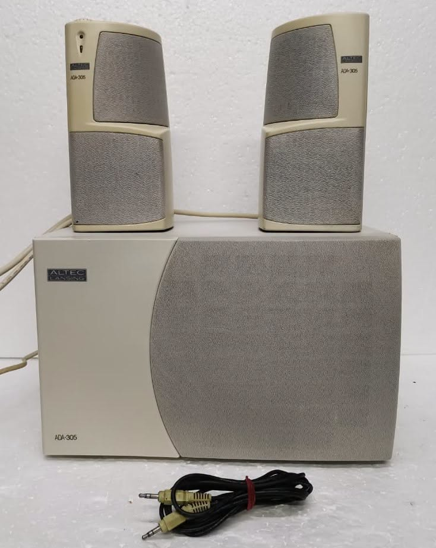

# ADA305 — safe Linux control for Altec Lansing USB speakers



A small Python library and CLI for the Altec Lansing **ADA305** USB speaker
control link, reconstructed from the original Windows driver stack by static
analysis. It is intentionally conservative: the default command is read-only,
and writes are validated, previewable, and verified by reading them back.

The ADA305 is the hardware reference and the only model implemented. The other
Altec models recognised by the same driver family are documented in
[`docs/MODELS.md`](docs/MODELS.md).

> **Volume levels.** The CLI and library use a `0..100` scale: **`0` is
> minimum volume and `100` is maximum**. The wire protocol still stores
> attenuation in dB, so a larger register value is quieter; the mapping is
> handled for you.

---

## Safety model

The original Windows software is free to write any value in the hardware range.
This tool is not:

| Rule | Behaviour |
| --- | --- |
| Default action | `ada305` with no subcommand reads status and exits. |
| No clamping | Out-of-range or unknown values raise; they are never coerced. |
| Very loud digital levels need `--yes-very-loud` | Any `ada305 volume` change whose target is level `91..100` is refused without it. |
| Digital increases print a warning | A `volume` change that lowers attenuation warns on stderr, then proceeds. |
| No-op writes are skipped | A request that maps to the current attenuation sends nothing. |
| No hidden initialisation | The tool never resets, re-initialises, or writes at startup. |
| Direct volume writes | Volume writes go straight to `0x0200+n`; the `0x0500 = 2/3` bracket ALSERV uses stalls with `EPIPE` on this unit and is not sent. |
| Read-back verification | Every write is read back; a mismatch is an error. |
| Interrupt monitor is read-only | Physical-control reports are decoded, never applied. |
| Follower applies physical controls | `ada305 follow` applies wheel clicks in both directions with no extra opt-in, because they are direct user actions. It still rejects non-`±1` deltas and out-of-range steps. |
| Tests never touch hardware | All tests use `FakeTransport`; there is no opt-in live test. |

A no-op at level `91..100` is allowed without the flag because it sends
nothing. The CLI exits with status `3` for any refused write and `1` for a
device or transport error. A dry run (`--dry-run`) still reads the device to
build and print the plan, but sends nothing.

---

## Requirements

* Linux with `usbfs` (any normal distribution).
* Python 3.9+ and [pyusb](https://pypi.org/project/pyusb/).
* Permission to open the device node (`/dev/bus/usb/BBB/DDD`).

With Nix, you can run everything without installing anything:

```sh
nix-shell -p 'python3.withPackages (ps: [ ps.pyusb ])' --run \
  'PYTHONPATH=src python3 -m ada305 status'
```

Or use the flake (Python, pyusb, pytest, ruff, and libusb are pinned):

```sh
nix run .# -- list-devices
nix run .# -- status          # needs device permission; see below
nix develop                   # dev shell with pytest, ruff, usbutils
nix build                     # ./result/bin/ada305
nix flake check               # builds the package and runs the test suite
nix fmt                       # format flake.nix with nixfmt
```

Or install into a virtual environment:

```sh
python3 -m venv .venv
. .venv/bin/activate
pip install -e .
ada305 status
```

### Device permissions

The raw device node is usually `root:root 0664`, so a normal user cannot open
it. Either run the read-only commands with `sudo`, or install a udev rule:

```udev
# /etc/udev/rules.d/60-altec-ada305.rules
SUBSYSTEM=="usb", ATTR{idVendor}=="04d2", ATTR{idProduct}=="0305", MODE="0660", TAG+="uaccess"
```

Reload with `sudo udevadm control --reload-rules && sudo udevadm trigger`.
No kernel driver is bound to the vendor interface; the tool does not detach or
rebind anything (except claiming interface 0 for the interrupt monitor and
follower).

---

## CLI

```text
ada305 [options] [command]

commands:
  status        read mute, volume, and mode (default)
  mute on|off|toggle
  volume CHANNEL LEVEL
  follow        apply the speaker's physical wheel and buttons
  release       explain control in USB mode (does not write)
  raw-read REGISTER [--length N]
  monitor       decode interrupt-IN reports (read-only)
  list-devices  list matching USB devices
```

Common options: `--bus N`, `--address N`, `--timeout MS`,
`--yes-very-loud`, `--dry-run`, `--verbose`.

Options work before or after the subcommand.

### Read status

```sh
sudo env PYTHONPATH=src python3 -m ada305 status
sudo env PYTHONPATH=src python3 -m ada305 status --json
```

Example output:

```text
ADA305 Speakers (04d2:0305, bus 001 address 011)
Mute:            off
Mode:            0 (state byte 1, mode byte 0)
Volume:          0 = minimum, 100 = maximum
Master:           56/100  (56 dB attenuation)
Left:            100/100  ( 0 dB attenuation)
...
Surround right:  mirrors surround-left (level 0/100, 31 dB); register 0x206 is not an independent ADA305 control
```

### Set the volume

```sh
# Preview first: this reads the device and prints the exact request.
python3 -m ada305 volume master 50 --dry-run

# Apply.
python3 -m ada305 volume master 50
```

`0` is minimum and `100` is maximum. A change that makes the speaker louder
prints a warning but does not need another flag:

```sh
python3 -m ada305 volume master 60
# WARNING: this is a volume INCREASE (more loudness).
```

Levels above `90` need `--yes-very-loud`, and the warning says so:

```sh
python3 -m ada305 volume master 95 --yes-very-loud
```

Without the flag the write is refused before anything is sent:

```sh
python3 -m ada305 volume master 100
# -> refusing: volume level 100 is above 90; pass --yes-very-loud to permit it
```

### Mute

```sh
python3 -m ada305 mute on
python3 -m ada305 mute off    # warns before unmuting
python3 -m ada305 mute toggle --dry-run
```

### Use the speaker's own wheel and buttons

In USB mode the speaker does **not** apply its own wheel or button changes. It
only reports them on interrupt-IN endpoint `0x81`; the host must apply them.
That is why turning the wheel can click while nothing changes when only a
read-only monitor is running.

`follow` applies those reports in both directions. Physical wheel clicks are
direct user actions, so there are no permission flags:

```sh
# Apply wheel clicks and buttons.
python3 -m ada305 follow

# Decode events without writing.
python3 -m ada305 follow --dry-run
```

The digital `volume` command still gates levels above 90 with
`--yes-very-loud`; that gate is not applied to the physical wheel.

Press a channel selector to route the wheel to subwoofer, center, or surround;
press the same selector again (or wait three seconds after the last volume
change) to return the wheel to master. The mute combination toggles mute.

Wheel reports are only accepted with a delta of `+1` or `-1`. The speaker has
emitted spurious idle reports such as `00 3c` (delta `+60`); those are ignored
instead of causing a large jump.

The follower is a foreground process; stop it with Ctrl-C. It applies each
wheel click directly and verifies the read-back. One physical detent emits
several identical reports, so packets from one detent are coalesced into a
single step (0.4 s window, `--wheel-debounce`). A click that would leave the
documented attenuation range is ignored, never clamped.

### `release` and register `0x0500`

ALSERV brackets host volume changes with `0x0500 = 2` / `3`. On the reference
ADA305 that write stalls with `EPIPE`; direct volume writes work and verify
without it. `ada305 release` therefore performs **no write**. It explains the
situation and points at `follow`:

```sh
python3 -m ada305 release
```

### Raw reads and monitoring

```sh
python3 -m ada305 raw-read 0x200 --length 2
python3 -m ada305 monitor --count 5
```

`monitor` listens on interrupt-IN endpoint `0x81`, decodes the report layout
used by ALSERV, and never applies the requested change. The endpoint's maximum
packet size is `2` bytes on the ADA305, so the default read is `2` bytes (not
ALSERV's 7-byte Windows buffer). If you pass a larger `--length`, the transport
rounds the USB buffer up to a whole number of packets and trims the result;
that prevents the `EOVERFLOW` crash that used to happen on a physical button
press. Reports are only generated when a physical control is used; idle reads
time out, which the monitor reports and then continues.

If the wheel or buttons appear dead, that is expected while no follower is
running. Use `ada305 follow` to apply them; `monitor` itself never writes.

### List devices

```sh
python3 -m ada305 list-devices
```

---

## Library

```python
from ada305 import Ada305, Follower, FollowerSettings, PyUsbTransport

with PyUsbTransport.open() as transport:
    device = Ada305(transport)

    status = device.read_status()
    print(status.volume_level("master"), status.volume_db("master"))

    # Prepare = read current value + validate policy. Sends nothing.
    plan = device.prepare_volume("master", 60)
    print(plan.describe(), plan.encoded.hex(" "))

    # Execute after you have decided to apply the plan.  This is a direct
    # register write; the unusable 0x0500 bracket is not sent.
    result = device.execute_volume(plan)
    print(result.level, result.db, result.changed)

    # Apply one exact attenuation step (the physical-control primitive).
    print(device.write_channel_db("master", 61))

    # Apply reported physical wheel/button events. Physical increases are
    # direct user actions, so the follower needs no opt-in.
    follower = Follower(device, FollowerSettings())
    report = device.read_interrupt(timeout_ms=2000)
    follower.handle_report(report)
```

`prepare_volume` accepts the 0..100 level. Any target above `90` requires
`allow_very_loud=True` unless the request is a no-op. Out-of-range levels,
unknown channels, and mirrored channels raise `SafetyError` subclasses.
`execute_volume` re-reads the register immediately before writing and aborts if
it changed while planning. All writes verify the read-back.
`write_channel_db` writes one exact attenuation step and refuses anything
outside the channel's documented range; it does not clamp.

The transport is a small protocol (`read_control`, `write_control`,
`read_interrupt`), so the device layer is easy to test with a fake; see
`tests/conftest.py`.

---

## Testing

```sh
nix-shell -p 'python3.withPackages (ps: [ ps.pytest ps.pyusb ])' --run \
  'PYTHONPATH=src pytest'
```

The suite covers codecs, channel aliases, the 0..100 mapping, every range and
very-loud refusal, no-op handling, exact write encodings, direct writes,
follower wheel/selector/mute debounce, physical increase handling, rejection of
anomalous wheel deltas, channel timeouts, interrupt buffer rounding and overflow
handling, read-back mismatches, and CLI option placement. No test opens a real
USB device, and there is no test that performs a real volume write.

---

## Documentation

* [`docs/PROTOCOL.md`](docs/PROTOCOL.md) — control transfers, register map,
  volume encoding, mode/state logic, interrupt reports, and evidence.
* [`docs/MODELS.md`](docs/MODELS.md) — ADA310/600/315/355/495 and legacy
  profiles, with ranges and what is (not) implemented.
* [`archive/`](archive/) — archival tarball of the original AMS24 installer
  and the two-disk ADA305 driver set, with hashes. Those binaries remain the
  property of their original authors; the project source is separate.

## Limitations

* Only the ADA305 (`04d2:0305`) is implemented and tested on hardware.
* `ADA495` shares the ADA305 protocol and ranges and should work, but has not
  been tested here.
* The interrupt report model is confirmed by live capture on the reference
  unit: `10`/`20`/`40` select subwoofer/center/surround, `01` toggles mute,
  `00 01`/`00 ff` are wheel clicks, and `80` is reconnect. `monitor` remains
  read-only; only `follow` applies reports.
* Writing `0x0300` with ALSERV's selector values was accepted by the device but
  did not light the channel LEDs on the reference unit. `follow` does not write
  it; channel selection is tracked host-side.
* Mode switching is read but deliberately not writable: the exact side effects
  of writing `0xA500`/state are not needed for safe volume control.
* `0x0500 = 2/3` is the host/local handoff observed in ALSERV, but the write
  stalls with `EPIPE` on this unit and is not used. Direct volume writes work
  and verify without it; `release` performs no write.
